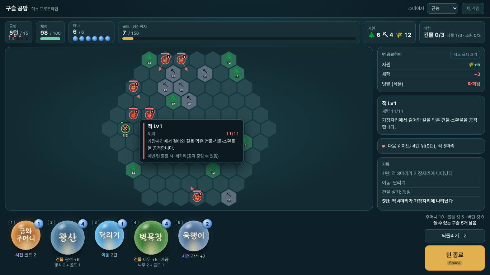

# 구슬 공방 — 헥스 프로토타입 (웹)

한 스테이지(15턴)를 직접 플레이해 보는 프로토타입. 규칙은 **파이썬**(`engine.py`), 새 구슬은 **실제 Jev 호출**(`orbs.py`, 구슬 만드는 규칙은 `sim/orbsim.py`에서 생성한 `vendor/orbmake.py`), 화면은 브라우저(`index.html`·`app.js`)가 그리기만 한다. **서버는 기억이 없다**: 게임 상태 전체가 서명된 덩어리(약 7KB)로 요청마다 오가므로 Vercel 서버리스에 그대로 올릴 수 있다. 모든 수치는 임시 값.



**이동·식물·툴팁**(2026-11-06):
- **이동**: 플레이어는 이제 가운데에 고정이 아니다. 이동 구슬(`role=move`, 시작 구슬 "달리기")을 쓰면 주변 2칸 안의 빈 칸으로 옮겨 가고, 건물·식물·소환물 배치 범위와 적의 목표·접근 판정이 새 위치를 따른다. Jev가 만든 이동 구슬("순간이동" 등)은 이동 뒤에 자기 효과(Jev는 속도 계열이라 `마나 +1`을 줌)도 적용한다. **소환물 이동은 아직 없음.**
- **식물**: 경작지(스테이지당 25)를 쓰는 건물형 구슬 = 재배(`grow`)나 식량 수확(`harvest food`)을 첫 효과로 가진 구슬(예: 사과나무·해바라기·당근 밭·텃밭). 건물 칸과 별도로 **식물 3칸**, 심은 뒤 2턴 자라는 동안 수확이 없고(🌱→🌿) 다 자라면 매 턴 수확(🌾 식량·🌻 골드·🌳 나무). 적이 건물처럼 공격한다. 물·날씨는 미구현.
- **툴팁**: 구슬·지도의 유닛·자원 칸·놓을 수 있는 칸에 마우스를 올리면 커서 옆에 뜬다(구슬: 전체 효과·재료·성장, 건물/식물: 체력·성장 단계·이번 턴 종료 시 받을 피해, 적: 체력·상태·이번 턴 이동 예정). 오른쪽 정보창도 그대로 있다.

**구슬 모양**(`toys/card-forge`의 유리구슬을 줄여 옮김): 손패의 구슬은 카드가 아니라 구슬로 그린다. 색=효과 종류(피해 빨강·방어 파랑·회복 초록·골드 황금·채집은 자원색 …, 이름으로 살짝 변주), 크기=마나, 속무늬=구슬 종류(건물 동심원·소환 방사·이동 빛무리), 겉에는 가비아 봄바람 글씨로 새긴 이름만(두 줄까지). 효과 한 줄 요약은 구슬 밑에, 자세한 문장은 마우스를 올리거나 선택하면 오른쪽 정보창에 나온다. Jev에게 색을 따로 묻지는 않는다(card-forge와 다른 점). 글꼴은 `fonts/`에 복사해 둠(`sync_vendor.py`가 관리, 라이선스는 `toys/card-forge/fonts/README.md`). 빈 구슬 등급별 재질(t0~t3)·깨짐 표시는 아직 안 옮김.

화면 편의 기능(테스트플레이용):
- **턴 종료 예측**: 오른쪽 위 "턴 종료하면" 패널에 골드·자원·체력 변화, 처치, 파괴될 건물, 새 적 수가 미리 나온다. 복사본으로 턴 종료를 미리 돌려 보는 것이라(`op=preview`, 난수 상태까지 같음) 실제 결과와 같다. 지도에는 적의 이동 방향(점선 화살표)·새 적 등장 칸·피해 받을 건물이 겹쳐 보인다(끌 수 있음).
- **되돌리기**: `Z`/`Ctrl+Z`/버튼. 직전 행동(구슬 사용·턴 종료)을 무제한(80단계) 되돌린다. 결과 화면의 **같은 판 다시**는 같은 맵·주머니·적 등장으로 다시 시작한다.
- **빠른 배치**: 구슬을 칸으로 **끌어다 놓기**, 구슬 **더블클릭**, 구슬 선택 뒤 **Enter**(또는 같은 숫자 키 한 번 더)로 추천(초록) 칸에 바로 놓기.
- 구슬은 `1`~`9`, 턴 종료는 `Space`, 선택 취소는 `Esc`. 구슬을 고르면 마나 소모·놓을 자리가 미리 보이고, 쓸 구슬이 없으면 턴 종료 버튼이 깜빡인다. 턴이 끝나면 변화가 숫자로 뜬다.

## 실행 (내 PC)
```
python proto/server.py            # http://localhost:8010  (PORT 환경 변수로 변경)
```
- 새 구슬을 만들 때 Jev를 부르므로 **`JEV_API_KEY` 환경 변수**가 필요하다(클라우드는 프록시가 붙여 줌). 키 없이도 시작 구슬 8개로 플레이는 된다(구슬 만들기만 실패).
- 윈도우 PowerShell: `$env:JEV_API_KEY="..."` 후 `python proto/server.py`.

## 웹에 올리기 (Vercel)
빈 구슬 공방 장난감과 같은 방식이다. **새 Vercel 프로젝트**를 만든다(장난감 프로젝트와 별개).
1. Vercel에서 이 GitHub 저장소를 Import, **Root Directory = `proto`**, Framework Preset = Other.
2. 환경 변수: `JEV_API_KEY`(필수, 장난감과 같은 키), `STATE_SECRET`(권장, 아무 긴 무작위 문자열; 없으면 `JEV_API_KEY`로 서명), `ACCESS_CODE`(선택, 걸면 화면이 코드를 물어봄 — 공개 주소의 Jev 비용을 막고 싶을 때).
3. Production Branch를 이 브랜치(또는 main에 합친 뒤 main)로 지정하고 Deploy. 열면 `index.html`이 뜨고 `/api/app`이 함수다.
- **proto 폴더만으로 완결**되게 만들었다(Vercel은 Root Directory 밖 파일을 못 가져올 수 있어서). 시뮬레이터·축·`forge.py`가 바뀌면 `python proto/sync_vendor.py`로 `vendor/`와 `data/`를 다시 만들고, `python proto/sync_vendor.py --check`로 어긋남을 확인한다.
- 주의: 이 저장소 작업 환경에서 Vercel 자체는 시험하지 못했다(같은 코드를 `proto`만 복사한 폴더에서 실제 Jev 호출과 함수 핸들러로 시험함).

## 한 판의 흐름
1. **빈 구슬 2개에 이름 쓰기**: 평범한(새겨진 말 50%)·깨끗한(25%) 빈 구슬. **재뽑기 없음.** 새겨진 말은 이름과 합쳐져 Jev가 전체를 읽고, 글자 수 한도(8자)에 포함된다.
2. **스테이지 15턴**: 헥스 맵(반지름 5)의 가운데가 플레이어. 도미니언식 턴 — 손패 5장 뽑기, 마나 6, 남은 구슬은 턴 끝에 전부 버림, 주머니가 비면 버린 더미를 섞음.
3. 구슬을 눌러 사용. **건물·소환은 칸을 골라 놓는다**(플레이어 주변 2칸 안). 노란 칸 = 놓을 수 있음, **초록 칸 = 보너스**(채집 건물은 맞는 자원 타일 옆, 그 밖에는 다른 계열 건물 옆).
4. **턴 종료** → 효과·건물·소환물이 작동하고 적이 움직인다. 적은 1·5·9턴에 가장자리에 나타나 플레이어 쪽으로 걷고, 길을 막은 건물·소환물을 공격한다.
5. 15턴 후 남은 자원을 0.3배로 팔고 **정산(골드 150)**. 쓰러지면 그 스테이지에서 번 골드·자원을 잃는다.

## 규칙(시뮬레이터 `r4`와 동일 계열)
- 같은 턴에 같은 계열 효과를 반복하면 ×0.6씩 약해짐, 약화·행동 불가인 적에게 피해 ×1.5, 직접 골드(구슬이 바로 주는 돈)는 이미 ×0.25가 구슬에 반영됨.
- 건물 3칸·소환물 3칸. 주머니의 40% 이상이 건물 구슬이면 건물 5칸(전직), 소환도 같음.
- 채집 건물은 **1칸 이내의 자원 타일**에서만 채집(자원 타일 옆이면 ×1.5). 자원 타일은 시전 채집(곡괭이)은 3칸 이내. 서로 다른 계열 건물이 붙어 있으면 건물당 +20%.
- 가공(`process`)은 원료를 골드 ×1.5로 바꿈. 적대 소환 구슬로 부른 적의 처치 보상은 ×0.3.
- 스테이지 종류: 균형 / 적 많음 / 자원 많음.

## 아직 없는 것 / 알려진 한계
- 한 스테이지뿐(런·보상·상점·보스·금박·전직 UI 없음). 시작 구슬 10개 고정(금화 주머니, 화염검×2, 방패, 곡괭이, 병사, 벌목장, 광산, **달리기**(이동), **텃밭**(식물)).
- **구슬 한계(마나 5~12)와 파손 없음**, 구슬 값이 비용(가치 기반)으로 들어가 있음.
- 겨냥은 자동(가장 가까운 적 등), 소환물은 제자리에서 싸움(이동 없음), `move`는 시전으로 처리, `remove`·`transform`은 효과 없음.
- 한국어만, 이름 규칙은 장난감의 `forge.check_name`을 그대로 사용.
- 게임 상태는 화면이 들고 있다(새로고침하면 사라짐, 저장 기능 없음).
- 한 스테이지 정산 150은 무작위 봇 38%, 건물 우선 봇 64% 통과(시험 값). 적 많음 스테이지가 가장 쉬운 것은 시뮬레이터에서 확인한 약점 그대로(처치 보상이 커서).

## 파일
`engine.py` 헥스 규칙 · `orbs.py` 구슬 만들기·설명·새겨진 말 · `core.py` 상태 없는 요청 처리 · `server.py` 내 PC용 서버 · `api/app.py` Vercel 함수 · `index.html`/`style.css`/`app.js` 화면 · `vendor/`·`data/` 생성물(`sync_vendor.py`)
